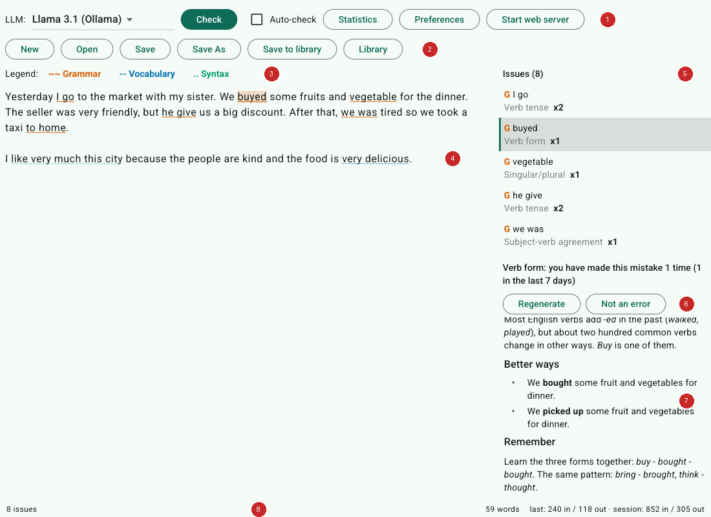
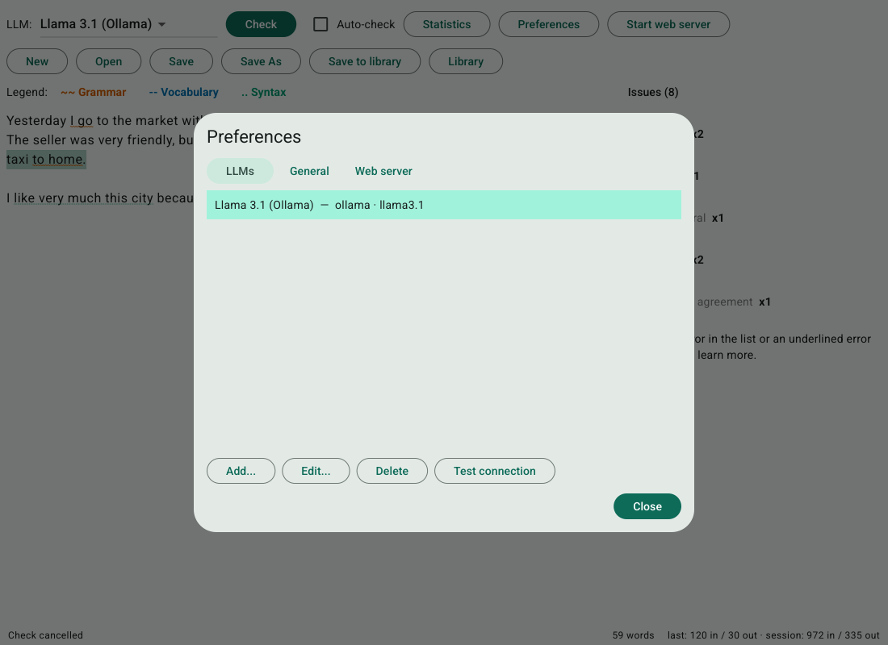
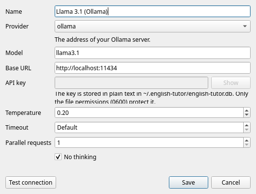
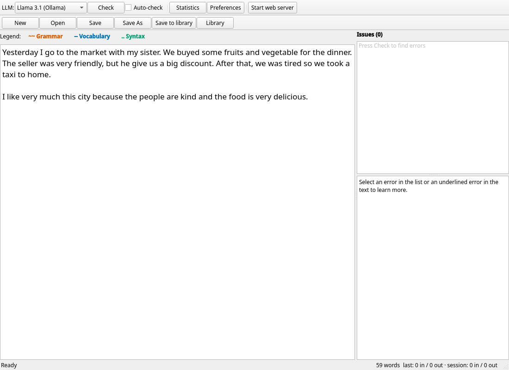
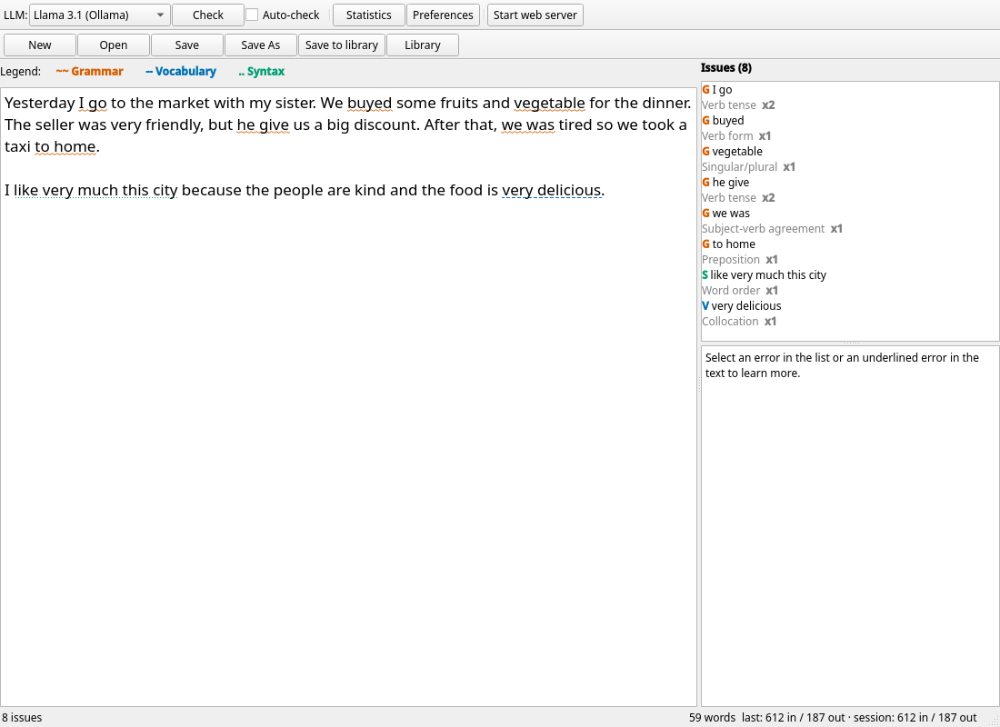
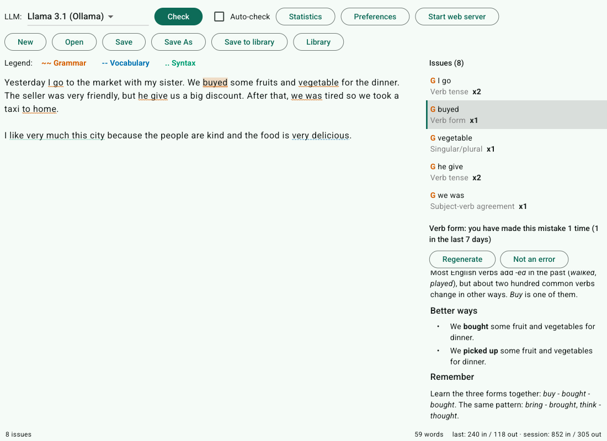
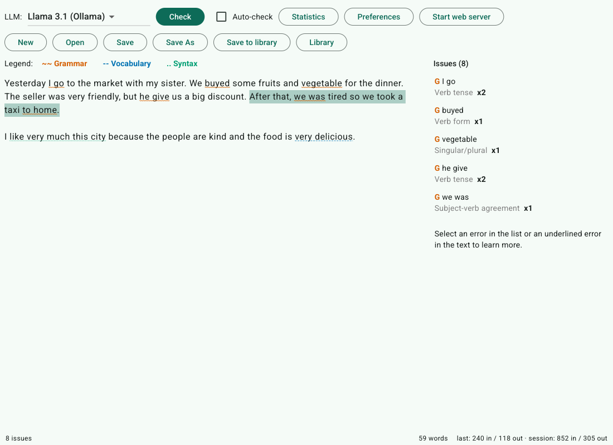
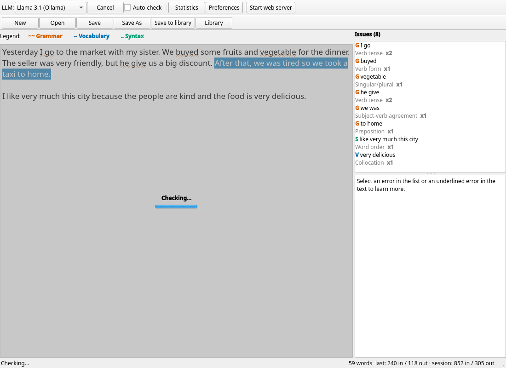
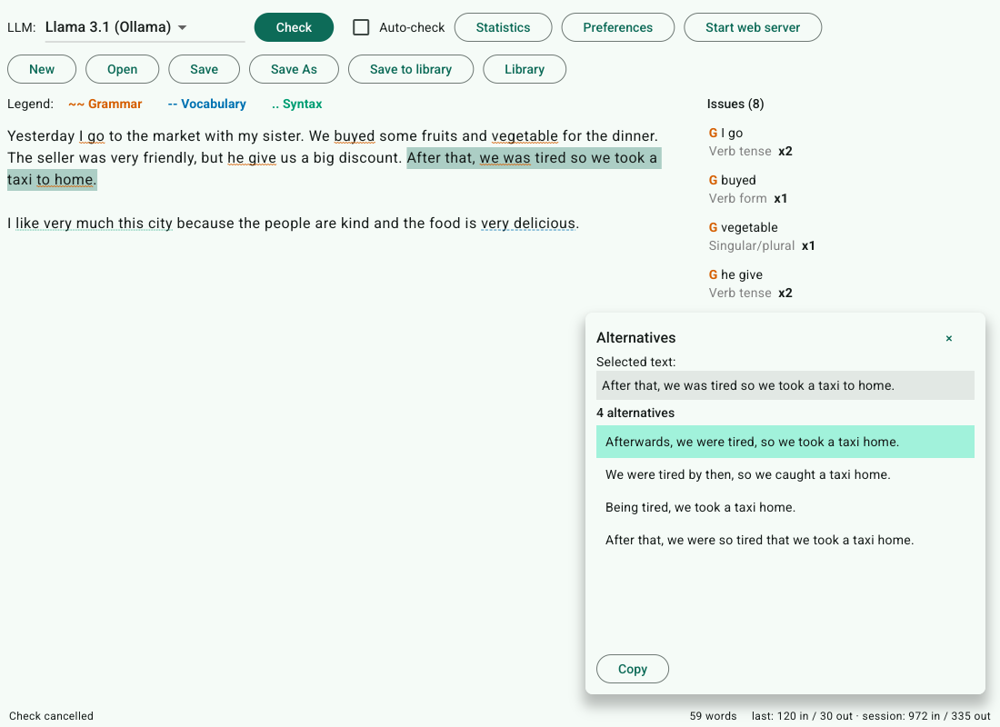
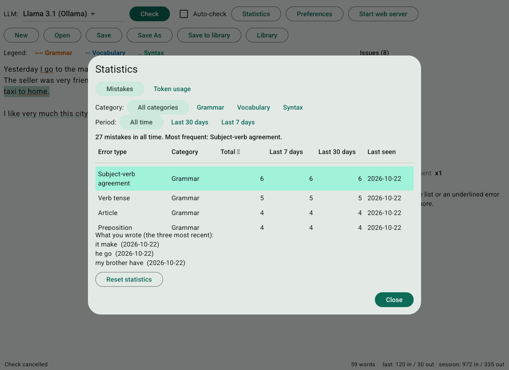

# English Tutor: a tutorial

English Tutor helps you improve your written English. You write (or paste) a text, an AI model, called an **LLM**, reads it and finds the mistakes, and the app underlines them in your text. Click a mistake to learn why it is wrong and how to say it better. The app also counts the mistakes you make, so you can see which ones you keep repeating.

This tutorial walks through the app from the first start to the statistics. It takes about 15 minutes. To install and build the app, see the [README](../README.md).

- [The window at a glance](#the-window-at-a-glance)
- [1. Connect an LLM](#1-connect-an-llm)
- [2. Write a text and check it](#2-write-a-text-and-check-it)
- [3. Read the underlines](#3-read-the-underlines)
- [4. Understand a mistake](#4-understand-a-mistake)
- [5. Fix it and check again](#5-fix-it-and-check-again)
- [6. Check only one sentence](#6-check-only-one-sentence)
- [7. Find other ways to write something](#7-find-other-ways-to-write-something)
- [8. See your progress](#8-see-your-progress)
- [9. Save your work](#9-save-your-work)
- [More things to know](#more-things-to-know)
- [When something goes wrong](#when-something-goes-wrong)

## The window at a glance

| | Part | What it is for |
|---|---|---|
| 1 | **Toolbar** | Choose the LLM, press **Check**, switch **Auto-check** on or off, open **Statistics** and **Preferences**, start the web server. |
| 2 | **File buttons** | New, Open, Save, Save As, and the library of texts kept inside the app. |
| 3 | **Legend** | The three kinds of mistakes and how they are underlined. Click one to hide or show it. |
| 4 | **Text editor** | Your text. Mistakes are underlined here. |
| 5 | **Issues list** | Every mistake found, one row each. It follows the editor: select one and the other moves with it. |
| 6 | **Mistake header and buttons** | Which kind of mistake is selected and how often you have made it. **Regenerate** asks for a new explanation, **Not an error** removes a wrong finding. |
| 7 | **Explanation** | What is wrong, why, better ways to write it, and a tip to remember. |
| 8 | **Status bar** | The state of the check, the number of words, and how many tokens (the LLM's unit of text) were used. |

## 1. Connect an LLM

English Tutor does not contain an AI model: it uses one you choose. You need one of these:

- **Ollama**, a free program that runs models on your own computer. Your text never leaves your machine. Install it from [ollama.com](https://ollama.com) and run `ollama pull llama3.1` once.
- **An OpenAI-compatible server**, which is what many services and local tools offer.
- **Anthropic** (Claude), with an API key. A service that offers Claude through the Anthropic protocol (some gateways do) also works with this choice.

Click **Preferences**. On the **LLMs** tab, click **Add...**.

Fill in the form:

| Field | What to enter |
|---|---|
| Name | Any name you like. It appears in the LLM selector. |
| Provider | `ollama`, `openai-compatible` or `anthropic`. |
| Model | The model's name, for example `llama3.1`. |
| Base URL | For Ollama: `http://localhost:11434` (the app fills it in). For an OpenAI-compatible server: its address, ending in `/v1`. Anthropic needs none; for a gateway that speaks the Anthropic protocol, its address ending in `/v1`. |
| API key | Needed for Anthropic and for most online services; not for Ollama. **Show** reveals what you typed. |
| Temperature | How creative the model is. Leave `0.2`: for checking mistakes you want steady answers. |
| Timeout | How long one request may take, in seconds (10 to 3600). Leave it on **Default** (empty in the browser): 15 minutes for a check, 2 minutes for an explanation or alternatives. |
| Parallel requests | How many parts of a long text are checked at the same time (1 to 16). `1` sends them one after another. With `4`, a long text is cut into about four parts that are checked together, which is much faster; but some providers refuse too many requests at once. |
| No thinking | Ticked for a new LLM. Leave it ticked for models that think before they answer (many "flash", Qwen, GLM and DeepSeek models). They answer at once, which is much faster. If the server answers with an error about an unknown field, untick it. It does nothing for Anthropic. |

Press **Test connection**. A success message with the time the model took means you are ready; otherwise the message tells you what failed. Then press **Save** and **Close**.

> **Which provider for which model?** Some services give each model its own protocol. For example, OpenCode serves DeepSeek and GLM through the OpenAI-compatible one and Claude through the Anthropic one, but Gemini and GPT models through protocols this app does not speak yet; asking for them gives "Model does not support this protocol". Free tiers of some services may only be used from their own tools and answer with an error (403) when called from here. Use a model of the protocol you chose, or one from a paid plan.

> **Privacy:** when you check a text, ask for an explanation or ask for alternatives, the text is sent to the LLM you selected. With Ollama on your own computer it stays there. If the server is on the internet, the form tells you so. API keys are stored as plain text in `~/.english-tutor/`, protected only by file permissions.

## 2. Write a text and check it

Type or paste some English into the editor. A paragraph or two is a good size. This one has several mistakes on purpose:

Press **Check** (or `Ctrl+Return`). While the LLM works, a grey layer with **Checking...** covers the editor and the text cannot be changed, so that the result matches what you wrote. You can press **Cancel** (the Check button changes into it) at any time. Long texts are sent in pieces, so they can take a little longer.

Some models take a minute or more. After 10 seconds the layer adds the line **We will notify you when the results are ready.** You can then switch to another application, or hide the window in the tray. When the check ends, and you are not looking at the window, the app shows a desktop message next to the tray icon, "Check finished" with the number of issues or "Check failed" with the reason, and asks the desktop to flash the window. Click the message to bring the window back. Nothing is shown when you are already looking at the window, after Cancel, or for Auto-check. (Without a system tray only the flashing is done.)

## 3. Read the underlines

When the check ends, the mistakes are underlined and listed:

Each kind of mistake looks different, and not only by colour, so that they can be told apart by everyone:

| Kind | Colour and line | What it covers | Letter in the list |
|---|---|---|---|
| **Grammar** | orange, wavy | verb forms and tenses, agreement, articles, prepositions, plurals... | G |
| **Vocabulary** | blue, dashed | a wrong word, confused words, collocations, spelling | V |
| **Syntax** | green, dotted | word order, a missing or extra word, run-on sentences, punctuation | S |

- **Hover** an underline to see the name of the mistake and a short hint.
- Use the **legend** above the editor to hide a kind you are not working on today.
- `F7` jumps to the next mistake and `Shift+F7` to the previous one.
- The grey **x2** next to a row says how many times you have made this kind of mistake so far. It is your own history, from the statistics.

The status bar says how many issues were found. Sometimes the LLM names a mistake in words that are not in your text; those cannot be underlined and are counted as "could not be placed".

## 4. Understand a mistake

Click an underline in the text, or a row in the list. Both are selected together, and the explanation appears:

The explanation has up to four parts: **What is wrong**, **Why**, **Better ways** and **Remember**. It streams in as the LLM writes it. Under the list, the header tells you how often you made this kind of mistake ("you have made this mistake 1 time").

Three buttons help when the answer is not good enough:

- **Cancel** (while it is loading) stops the explanation.
- **Regenerate** asks the LLM again for a different explanation.
- **Not an error** is for when the LLM was wrong and your text was fine. The underline and the recorded count go away.

> LLMs make mistakes too. If an explanation seems wrong, trust your own judgement, press **Regenerate**, or use **Not an error**.

## 5. Fix it and check again

Correct the text in the editor. Underlines follow your edits: the ones after your change move along, and the one you edited disappears, because it no longer describes the text.

Press **Check** again to see what is left. A mistake you already made in this text is not counted twice, and fixing a mistake does not remove it from your history: the statistics show how often you *make* a mistake, not how many remain.

**Auto-check** (the box next to Check) checks again by itself when you stop typing for a few seconds. It is off by default. You can turn it on, and set the delay, in **Preferences**, on the **General** tab. Auto-check results are underlined but not counted in the statistics, because a half-written sentence would give false counts. Only the **Check** button counts.

## 6. Check only one sentence

Sometimes you have rewritten one sentence and want to check just that one. Select it with the mouse, right-click, and choose **Check**:

Only the selected text is sent to the LLM. The same grey layer covers the editor while it works, and your selection stays visible:

When it ends, the mistakes inside the selection are replaced by the new result, and every other underline stays as it was. The mistakes are counted in your statistics like any other manual check, and checking a sentence you already checked does not count it twice.

The **Check** entry is greyed out when no LLM is configured, and the menu does not offer it when only spaces or line breaks are selected. You can **Cancel** this check like any other.

## 7. Find other ways to write something

A text can be correct and still not sound right. Select a word, a sentence or a paragraph (up to about 600 words), right-click and choose **Alternative**. A window opens at once and lists other ways to write the same thing:

- **Double-click** an alternative to put it in your text in place of the selection. The window closes. If you change your mind, `Ctrl+Z` brings your words back.
- **Copy** puts the highlighted alternative on the clipboard instead.
- **Close** closes the window. You can keep writing in the main window while it is open.

If you typed in the selected place while the window was open, nothing is replaced and the window tells you, so that you never lose text by accident.

## 8. See your progress

Click **Statistics**. The **Mistakes** tab lists every kind of mistake you have made, how often, and when you made it last:

- Click a column title to sort. Use **Category** and **Period** to narrow the table (all time, 30 days or 7 days).
- Select a row to see your own words from the last three times you made that mistake. Seeing what you wrote is often the best way to remember the rule.
- The line above the table names your most frequent mistake: a good topic for your next practice.
- The **Token usage** tab shows how much each LLM was used, which matters if you pay per use.
- **Reset statistics** deletes the history, after asking you to confirm.

The mistakes you repeat count every time you repeat them. That is the point: the statistics show which rules to study.

## 9. Save your work

| Button | What it does |
|---|---|
| **New** (`Ctrl+N`) | Starts an empty text. |
| **Open** (`Ctrl+O`) | Opens a `.txt` or `.md` file. |
| **Save** (`Ctrl+S`), **Save As** (`Ctrl+Shift+S`) | Writes the text to a file. |
| **Save to library** | Keeps the text inside the app, with a title. |
| **Library** | Lists your saved texts: open, rename or delete them. |

If you close the app or start a new text with unsaved changes, it asks whether to save them. Underlines are not saved, so press **Check** again after opening a text. Your mistake statistics are kept, and checking an opened text again does not count its mistakes twice.

## More things to know

- **The system tray.** Closing the window with the X button only hides it, and a running check keeps going. Click the tray icon to bring it back; choose **Close** in the tray menu to quit.
- **Use it in a web browser.** Press **Start web server**, then open `http://localhost:3333/`. You get the same editor, list and explanations in the browser, and several tabs each have their own text. Right-click menus (Check on a selection, Alternative) are not in the browser version, and it does not show the 10-second hint or the desktop message when a check ends. Other computers can connect only if you set a password in **Preferences**, on the **Web server** tab. Use that only on a network you trust.
- **Make long checks faster.** In order of effect: tick **No thinking** for models that think before they answer; raise **Parallel requests** to 3 or 4; use a smaller model; check one sentence or paragraph instead of everything (step 6). If a check ends with "took longer than ...", raise the **Timeout** of that LLM.
- **Keyboard shortcuts.** `Ctrl+Return` check or cancel; `F7` / `Shift+F7` next / previous mistake; `Ctrl+N`, `Ctrl+O`, `Ctrl+S`, `Ctrl+Shift+S` for the file buttons.
- **Where your data lives.** Everything is in `~/.english-tutor/`: a database with your LLMs, library, statistics and settings, and a log that never contains your text.

## When something goes wrong

| What you see | What to do |
|---|---|
| **Check** is greyed out, and the panel says no LLM is configured. | Add one in Preferences (step 1). |
| A banner above the editor says the check failed. | Read the message. Open Preferences and press **Test connection** on that LLM: the server may be off (start Ollama), the address wrong, or the key invalid. The old underlines are kept. |
| The check is very slow. | See **Make long checks faster** above. Large models on a small computer are slow too. |
| "The request ... took longer than ...". | The model did not answer within the **Timeout** of that LLM. Raise it in Preferences, tick **No thinking**, or raise **Parallel requests** so each request is shorter. |
| "The model's answer was not in the expected format." | The model did not return the list of mistakes in the form the app needs. Press **Check** again. If the message says the answer was cut off, the text was too long for the model's output limit: check less text, or raise **Parallel requests** so each part is shorter. |
| An error with a number such as 400 or 403 and a message from the service. | The service refused the request. The message says why: the wrong protocol for the model, a key without access, or a field it does not know. If it names an unknown field, untick **No thinking** for that LLM. |
| Some mistakes are "could not be placed". | The LLM named words that are not in your text, so they cannot be underlined. Press **Check** again. |
| The LLM says something is wrong that is right. | Select it and press **Not an error**. It also leaves your statistics. |
| Nothing is underlined, but you know there are mistakes. | Some models are too small to find them. Try a larger model. |
